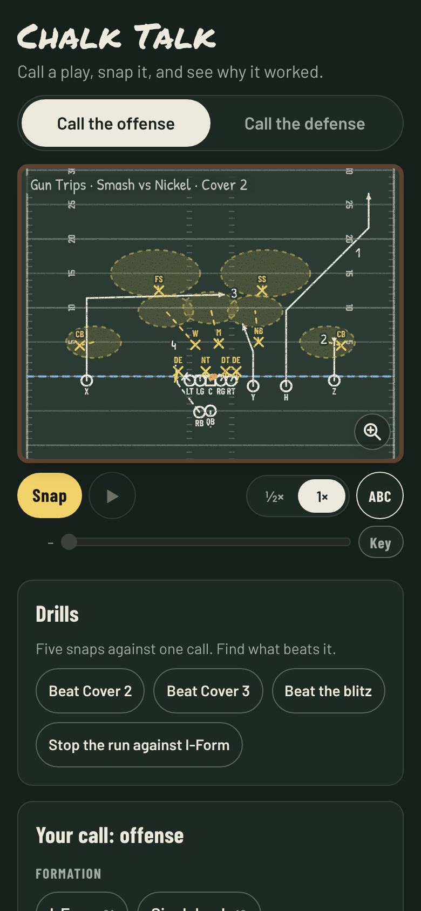
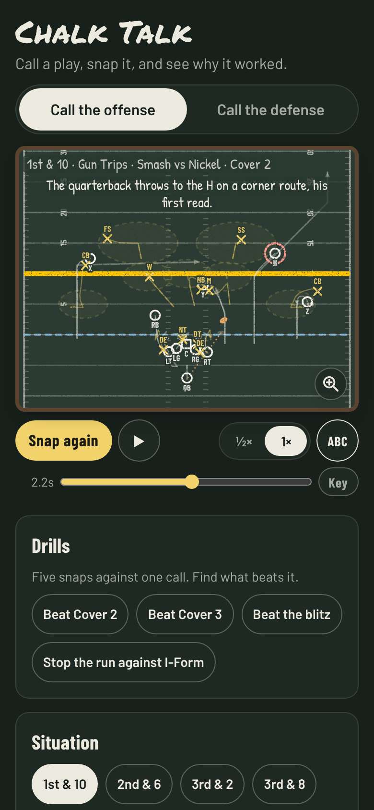
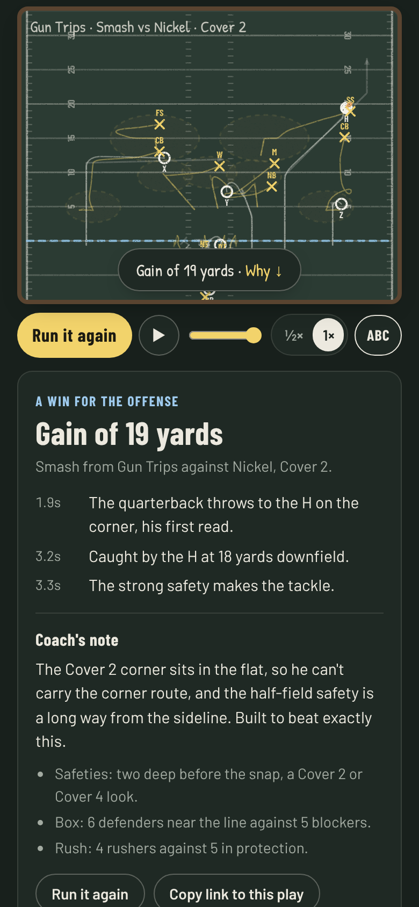

# Chalk Talk

**Use it: [chalk-talk.junkdrawer.works](https://chalk-talk.junkdrawer.works/)**

**A football coach's board you can run.** Call the offense or the defense, snap it, and watch every route, block, rush and coverage play out in Xs and Os. Afterwards it tells you what happened and why: who came free, how the call does against theirs, and how many blockers there were for the defenders in the box. Tap any player to learn his position and his job on that play.

<p align="center">
  
  &nbsp;
  
  &nbsp;
  
</p>

## How it works

- **Pick a side.** Call the offense (formation, strong side, play) or the defense (front, coverage, pressure). The other coach picks his call at random, the way a real one might: nickel against three receivers, base against two backs, and on offense more runs with two backs or two tight ends and more passes with four receivers. Or turn that off and call both sides to study one matchup.
- **Read it before the snap.** The other side's call stays hidden until the snap, but its alignment doesn't: count the safeties deep, see how far off the corners are and count the defenders in the box, the way a quarterback does. On a pass play the routes are numbered in the order the quarterback reads them. On a phone the magnifier in the board's corner zooms to the line, twice as big, so the linemen and their labels can be told apart; it follows the ball through the play, and zooms back out when it's tapped again. Don't like the look? Change your play and he keeps his call, the way an audible works; change your personnel and he substitutes. New look gets you another one. After the snap his card asks what he played, with the five coverages as buttons, and keeps his call back, on the board and in the coach's note, until you've answered; the answer says what gave it away ("Right: two deep and the corners about 5 yards off, Cover 2."), and a streak of right answers is kept on this device. A switch in his card turns the question off.
- **Snap it.** Every player has a job and does it: receivers run their routes, linemen block whoever they're assigned, rushers try to beat their blockers, man defenders chase their receivers a moment late, zone defenders guard their areas, and the quarterback goes through his reads and throws where nobody can get there first. The same call can come out differently each time.
- **Watch it back.** The board names the blitzers as they come and the run at the handoff. At the whistle a line is chalked across the field at the spot with the gain written beside it ("+17", "Sack −7", "Incomplete"), and after a long play the board pulls back to show the whole of it. Scrub through the play, with a clock beside the scrubber that keeps the play-by-play's time and, once the play is over, marks on it at the handoff, the throw and the catch, slow it to half speed, and see the drawn-up play faintly under the trails of where everyone actually went, and a dotted line for the throw. Tap a time in the play-by-play to watch that moment again, from a second before to a second after at half speed, the way a broadcast replays it, with the man it names ringed.
- **Find out why.** A play-by-play, a coach's note on how the call does against what the other side called and how this snap went (which read he threw to and what came of it, or on a run the numbers in the box and who made the tackle), and the pre-snap read: the safeties, the corners, the box count, and how many rushers came against how many blockers.
- **Run it a hundred times.** "Run it 100 times each" plays your call against every coverage (or your defense against every play) and charts how often it succeeds (gains 4 yards or more), with the average yards beside each bar. The first numbers are up after 20 snaps a row; then it keeps adding snaps, and the bars settle, until each row has 100.
- **Learn the words.** Tap any player for his position and his job on the play, or open "Every player's job" under the calls for a button for each one, from the keyboard too, and the board described in words. Key, under the board, opens how to read it beside the board, with a drawing of every mark: the routes, blocks, zone drops, man coverage, rushes and blitzes, in the board's own chalk. The playbook below the board covers positions, personnel, formations, technique numbers and gaps, coverages, plays and routes, and the other words coaches use: the strong side, the box, the zones.
- **Share a play.** "Copy link to this play" makes a link that replays exactly the same snap for whoever opens it.
- No account and no server. Your last calls stay in your browser. It works offline and installs to a phone's home screen.

The simulator is a coaching model, not physics. Blocks are pairs that push each other until one wins, coverage is defenders following receivers or guarding spots, and tackling is a dice roll weighted by angle and who's involved. Over many snaps it comes out near real football: about four yards a carry, about two passes in three complete, sacks on about one dropback in twenty-two. The classic matchups mostly work the way coaches draw them up: four verticals hurt Cover 2 most, Smash beats Cover 2, Flood beats Cover 3, crossing routes get open against Cover 1's man coverage, and Cover 3's extra safety in the box slows the run.

## Running it

It's a static site: plain HTML, CSS and JavaScript, with no build step.

```sh
npx serve .                   # or any static file server, then open the printed address
npm test                      # the simulator's tests, then the page and the one-file copy in Chromium (Playwright)
node tools/screenshots.mjs    # redraws docs/*.png and og.png
node tools/make-icons.mjs     # redraws the PNG icons from icon.svg
npm run build                 # dist/chalk-talk.html, the whole app in one file (needs esbuild: npm install)
```

To put it online with GitHub Pages: **Settings → Pages → Build and deployment → Deploy from a branch**, then pick `main` and `/ (root)`. The `CNAME` file serves it at chalk-talk.junkdrawer.works.

### Files

- `js/playbook.js`: the playbook as data: formations, routes, plays, fronts, coverages and zones, what each position does, and the coach's notes.
- `js/sim.js`: the simulator. `prepare()` lines both teams up and hands out every assignment (routes, blocking, protection, rush lanes, man matchups and zone drops); `simulate()` runs the snap at twenty steps a second and records every position, the events, and the result.
- `js/board.js`: draws the field, the players as Xs and Os, the drawn-up assignments and the trails, in chalk (dark) or marker (light).
- `js/app.js`: the page: the choosers, playback, the result and coach's note, the chart, the playbook, share links.
- `js/rng.js`: a seeded random source, so a snap replays exactly from its seed.
- `fonts/`: Barlow, Barlow Condensed, Permanent Marker and Patrick Hand (SIL Open Font License), served from here so nothing loads from elsewhere.
- `sw.js`: keeps a copy for using offline, and opens from it when the connection isn't answering. The copy is one whole release, replaced only once every file of the next one has downloaded, never file by file as pages load. `FILES` in it is a fingerprint of the files it keeps: change one and `npm test` says what to set it to, which is what makes a phone download the new release. A page whose signal drops partway through loading a new release says "Chalk Talk didn't finish loading." with a Reload button, rather than running half old and half new.
- `test/sim.test.mjs`: every call against every defense runs to a finish, formations are legal, coverages count right, the numbers look like football, and the matchups above come out as the README says. `test/e2e.mjs`: uses the real page in Chromium. `test/onefile.mjs`: builds the one-file copy and uses it, opened from a file and from a web address, and without its document wrapper (skipped without esbuild).
- `scripts/build.mjs`: bundles everything into one HTML file.
